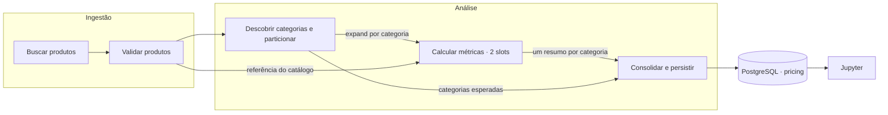

# Pipeline de preços com Apache Airflow

A DAG `precos_por_categoria` consulta a FakeStore API todos os dias às **06h de Brasília**. Ela publica no PostgreSQL a quantidade de produtos e os preços médio, mínimo e máximo por categoria. O projeto usa Airflow 3.4, PostgreSQL 16, Python 3.12 e `uv` para reproduzir as dependências do desenvolvimento e das imagens Docker.

## Executar

Instale Docker, Docker Compose v2.24.4 ou superior e Make. Execute os comandos na raiz do clone.

```sh
make up
make password
make trigger
```

Entre como `admin` com a senha gerada pelo Airflow. Abra `precos_por_categoria` e acompanhe a execução em **Graph**. O comando `make trigger` cria uma execução manual e retorna assim que ela for enfileirada. As portas da interface são locais e as credenciais são para desenvolvimento. [Airflow local](http://localhost:8080)

| Comando | Uso |
|---|---|
| `make status` | Ver os serviços. O serviço `init` termina com código zero após preparar banco, pool e permissões. |
| `make logs` | Acompanhar API, scheduler e processador de DAGs. |
| `make sql` | Abrir o PostgreSQL analítico. |
| `make check` | Conferir o lockfile e rodar Ruff. |
| `make test` | Rodar a suíte com tabelas temporárias em PostgreSQL. |
| `make smoke` | Testar T06 e T07 com catálogo controlado, scheduler real e banco isolado. |
| `make smoke-falhas` | Exercitar recuperação da API, rejeição de catálogo, rollback no PostgreSQL e alerta após esgotar os retries. Pode levar vários minutos pelo backoff. |
| `make notebook` | Executar a análise do snapshot e do histórico. |
| `make down` | Encerrar os serviços e conservar os dados nos volumes. |

### Usar Make no Dev Container

A imagem de desenvolvimento inclui o Make e o cliente PostgreSQL. Para atualizar um contêiner aberto, use **Dev Containers: Rebuild Container** no VS Code. No terminal integrado, `make` lista os comandos disponíveis. `make trigger`, `make sql`, `make check`, `make test`, `make notebook`, `make status` e `make password` funcionam nos dois terminais.

`make status` consulta a saúde do Airflow no terminal integrado e lista os serviços do Compose no terminal da máquina. `make password` mostra a senha local do usuário `admin`, guardada no volume compartilhado após a inicialização da API.

Use o terminal da máquina para `make up`, `make down`, `make logs` e os alvos `smoke*` e `demo-*`. Dentro do Dev Container, acompanhe a execução da DAG pela interface do Airflow.

O Ruff vem do grupo de desenvolvimento do `uv`. Rode `make check` no terminal integrado para conferir o lockfile e analisar o código. A extensão do VS Code usa o mesmo executável em `/opt/venv/bin/ruff`.

## Arquitetura da DAG



1. **Ingestão.** Consulta `GET /products` com timeout e grava o JSON de forma atômica no volume `catalogs`. O catálogo é identificado pela execução e pelo hash do conteúdo. O Airflow faz até três retentativas com espera exponencial. Os callbacks registram sucesso, retentativa e falha definitiva.
2. **T06 · Fan-out.** `ValidarProdutosOperator` verifica o catálogo. A descoberta agrupa os preços em arquivos por categoria e retorna a lista de nomes via XCom. O `.expand()` cria uma instância com nome da própria categoria. Cada instância lê somente seu arquivo e usa um dos dois slots de `ecommerce_pool`.
3. **T07 · Fan-in.** A tarefa final confere se recebeu exatamente um resumo por categoria esperada. Usa `PostgresHook` e a conexão `pricing_postgres` para publicar snapshot e histórico na mesma transação. Uma falha durante a escrita preserva a publicação anterior, e o Airflow faz até duas retentativas com espera exponencial. O bloqueio transacional por dia serializa publicações concorrentes daquela data.

### Contratos e tabelas

| Contrato | Granularidade e campos |
|---|---|
| `Produto` | Um produto da API, com ID inteiro positivo e único no catálogo, categoria normalizada e preço finito em `Decimal`. |
| `ResumoCategoria` | Uma categoria, com quantidade e preços médio, mínimo e máximo. A média usa duas casas decimais com `ROUND_HALF_UP`. |
| `ResumoXCom` | Representação JSON do resumo. Os valores decimais passam como texto e são reconstruídos antes da publicação. Os demais XComs carregam referências e nomes de categorias. |
| `precos_diarios` | Uma linha por `(data_referencia, categoria)`, com os resultados da execução mais recente daquele dia. |
| `precos_historico` | Uma linha por `(run_id, categoria)`. Novas execuções acrescentam observações. Repetir uma execução substitui apenas as próprias observações. |

A data de referência vem da data lógica convertida para `America/Sao_Paulo`. Disparos manuais sem data lógica usam o instante do disparo. A recência dentro de um dia usa o instante programado ou de disparo, gravado em `data_execucao`. Em empate, vence o maior `run_id` em ordem lexical. Reprocessar uma execução anterior atualiza seu histórico e preserva o snapshot da execução mais recente.

Abra `make sql` e consulte os dois grãos.

```sql
SELECT * FROM precos_diarios ORDER BY data_referencia DESC, categoria;
SELECT * FROM precos_historico ORDER BY data_execucao DESC, categoria;
```

Para repetir uma execução com o mesmo catálogo, abra seu grafo, selecione `analise.descobrir_categorias` e use **Clear** incluindo as tarefas downstream. Repita duas vezes e compare as consultas. Use `make smoke` para automatizar o cenário, verificar o pico observado de concorrência e demonstrar a entrada de uma quarta categoria.

### Operação em caso de falha

A busca e a persistência têm limite de 90 segundos por tentativa. Se todas as tentativas falharem, a execução fica com status `failed` e o callback registra um alerta simulado nos logs. Depois de corrigir a causa, use **Clear** na tarefa que falhou e inclua as tarefas downstream para retomar a mesma execução.

O agendamento depende do Docker e do scheduler ativos. O Compose usa um único host, e o alerta fica nos logs do Airflow. A política `catchup=False` evita gerar automaticamente todas as execuções perdidas durante uma interrupção.

### Horários e logs por etapa

Os processos do Airflow emitem JSON com timestamps ISO 8601 em UTC. O sufixo `Z` indica UTC. Em Recife e São Paulo, `09:00:00Z` corresponde a **06h locais**. A DAG usa `America/Sao_Paulo` para o agendamento e a data de referência do snapshot.

Na interface, escolha **Local** no seletor de fuso para usar o horário do navegador. Abra **Grid → execução → tarefa → Logs** para investigar uma tentativa. As instâncias mapeadas aparecem com o nome da categoria. No terminal, `make logs` acompanha scheduler, API e processador de DAGs.

Cada evento de etapa inclui `dag_id`, `run_id`, `task_id` e `try_number`. As etapas mapeadas também trazem `map_index`. Use esses campos para cruzar início, duração, conclusão, retentativas e falhas de uma execução. Os eventos de negócio registram o status HTTP da coleta, a quantidade validada, as categorias descobertas, a quantidade por categoria e a confirmação da publicação. O campo `snapshot_atualizado` informa se aquela execução atualizou o snapshot diário.

Os logs de tarefa ficam no volume `logs`, agrupados por execução, tarefa e tentativa. `make smoke` verifica os eventos estruturados das cinco etapas, e `make smoke-falhas` verifica também retentativas e alertas.

## Explorar os dados no Jupyter

Execute `make notebook` após uma publicação bem-sucedida. O comando gera `.artifacts/precos.ipynb` com a tabela do snapshot, o gráfico de preços por categoria e a consulta aos últimos 30 dias. O histórico aparecerá em gráfico quando a categoria escolhida tiver pelo menos duas datas de referência.

Para editar e executar as células interativamente, abra o repositório no **VS Code → Dev Containers: Reopen in Container**. Se o Dev Container já existia antes desta revisão, use **Dev Containers: Rebuild Container**. Rode `uv sync --locked --group analytics` no contêiner, abra o notebook e selecione o kernel `/opt/venv/bin/python`. A conexão `PRICING_ANALYTICS_DSN` aponta para o banco analítico com um papel PostgreSQL de leitura. [Notebook de preços](analytics/precos.ipynb)

## Organização do código

- `dags/precos_por_categoria.py` define o grafo, o agendamento e os parâmetros do Airflow.
- `dags/pricing_pipeline/` reúne contratos, coleta e particionamento, cálculo puro, operador de validação e persistência.
- `docker/` prepara os bancos, papéis e pool. O PostgreSQL mantém metadados do Airflow em `airflow` e métricas em `pricing`.
- `tests/` contém a suíte, o servidor de demonstração e os catálogos de teste. `scripts/smoke.sh` orquestra o ensaio de integração.
- `analytics/` contém o notebook de consumo. O grupo `analytics` do `uv` é instalado sob demanda.

Ao mudar dependências, versionar `pyproject.toml` e `uv.lock` juntos permite que as imagens e o Dev Container usem a mesma resolução. O Dockerfile fixa a versão de `uv` e usa `uv sync --locked --no-dev` na imagem de execução. Abra o [checklist com a revisão do enunciado](TASKS.md) para reproduzir os requisitos e os ensaios de falha.

Referências · [FakeStore API](https://fakestoreapi.com/docs) · [Dynamic Task Mapping](https://airflow.apache.org/docs/apache-airflow/3.4.0/authoring-and-scheduling/dynamic-task-mapping.html) · [Bloqueios no PostgreSQL](https://www.postgresql.org/docs/16/explicit-locking.html) · [Execução de notebooks via nbconvert](https://nbconvert.readthedocs.io/en/latest/execute_api.html) · [uv em Docker](https://docs.astral.sh/uv/guides/integration/docker/)
